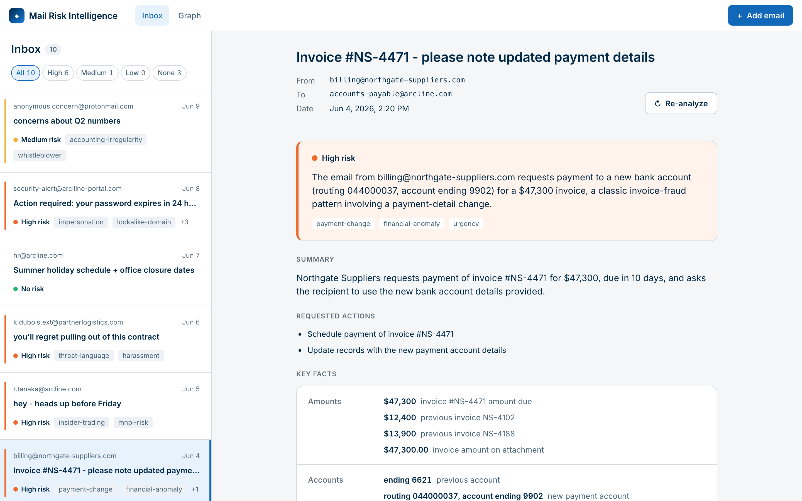
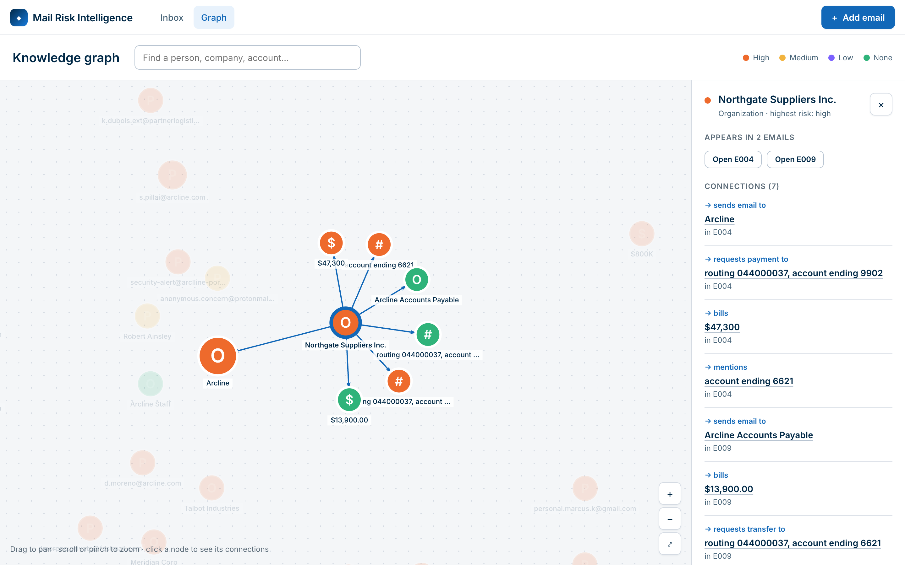
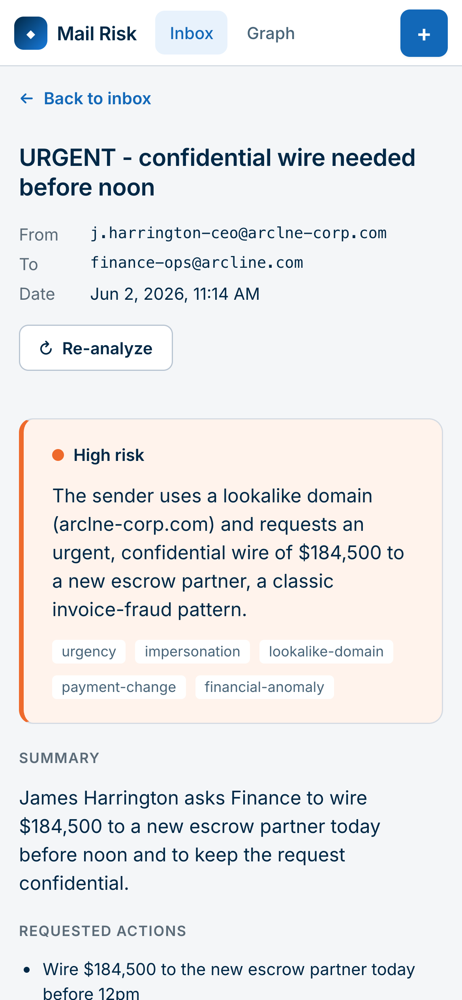

# Mail Risk Intelligence

Emails land in a mailbox, two chained AI agents analyze them, and the UI shows who is involved, what they want, and whether it looks risky (fraud, phishing, insider threat, market abuse, harassment).

> **Track: UI-focused.** Extra effort went into design, responsiveness, accessibility, UI states and the knowledge graph.
> **Time spent:** about 4h30 (30 min planning, 4h building). How I used AI tools: [PROCESS.md](PROCESS.md).



| Knowledge graph | Mobile |
| --- | --- |
|  |  |

## Run it

Requires Node 22.9+.

```bash
npm install
cp .env.example .env   # add a free Groq key (optional)
npm run dev            # http://localhost:5173
```

**Without a key the app still works:** the 10 seed emails load from a committed snapshot of their analysis, and new emails show a clear "AI service not configured" state with Retry. Try **Add email** with the files in [`samples/`](samples/).

`npm test` runs 99 tests (no API calls). `npm run eval -w server` checks the 10 seeds against my expected risk levels (10/10).

## Architecture

```
client/   React + TS (Vite). Components, CSS Modules, design tokens, hooks, API client
server/
  ingestion/  pasted text, .txt, .eml, .pdf -> one common email shape
  agents/     Groq client, Agent A (extraction), Agent B (risk + entities), zod schemas, orchestrator
  pipeline/   background queue, startup seeding, snapshot
  storage/    SQLite; entities are shared across emails so the graph can link them
  routes/     REST API (/api/emails, /api/emails/ingest, /api/emails/:id/retry, /api/graph)
shared/   types shared by client and server
```

Adding an email returns immediately as `queued`; a background queue runs Agent A then Agent B, and the UI polls only while something is pending.

## Key decisions

- **LLM: Groq free tier, `openai/gpt-oss-120b`.** Fast, no local install. The prompt knows the real domain (`arcline.com`) and has explicit severity rules, tuned over 4 eval runs to reach 10/10.
- **Failure handling.** Every model response is validated with zod; garbage is rejected. The orchestrator never throws: it retries transient errors once (timeout, network, 429/5xx, bad JSON), never retries a missing key, and stores `failed` with a reason. If Agent B fails, Agent A's extraction is still shown. A throttle reads Groq's token budget headers to avoid rate limits.
- **Styling: CSS Modules + CSS custom properties as design tokens.** No extra dependencies, scoped styles, and one file ([tokens.css](client/src/styles/tokens.css)) holds the whole design system. Color is reserved for risk; the palette is based on the hiring company's brand since Arcline is fictional.
- **Accessibility.** Risk is never shown by color alone, AA contrast everywhere, visible focus, keyboard navigation, skip link, native `<dialog>`, a keyboard-browsable entity list and search as an equivalent to the canvas graph.
- **Responsive.** Two panels from 900px, one panel with a Back button below that.
- **Caching.** LLM results are persisted, so restarts never re-analyze; the seed snapshot works as a precomputed cache.

## Tests and accessibility evidence

| Suite | Tests | What it covers |
| --- | --- | --- |
| Server: model output parsing | 14 | valid output, garbage (prose, truncated JSON, empty, wrong shape), normalization |
| Server: orchestrator | 8 | retry once on transient errors, no retry without a key, partial results, never throws |
| Server: ingestion | 21 | pasted text, the `.txt` / `.eml` / `.pdf` samples, renamed and malformed files (content is checked, not just the extension), error codes, display names with commas |
| Server: storage | 4 | entity de-duplication that links emails in the graph |
| Server: API (HTTP) | 9 | bad uploads return 400 and store nothing, library errors never reach the client, oversized files, valid upload is queued, 404 |
| UI: components | 21 | risk badge labels, failure and retry states, `hxxp://` never clickable, file validation, add email submit and error states |
| UI: accessibility (axe-core) | 5 | WCAG 2 A/AA rules on the inbox, loading/error states, email detail with entities, failed state, add email dialog |
| UI: token contrast | 17 | every text/background pair in `tokens.css` is at least 4.5:1 |

axe runs in jsdom, which cannot compute rendered colors, so contrast is checked from the design tokens instead. On top of the automated suite, I ran a full-page axe audit in the browser on the inbox, email detail, graph and add email dialog at 375, 768, 1280 and 1440px, and tested keyboard-only navigation (0 violations after fixing 3 issues it found).

## Limitations and next steps

- LLM output is not fully deterministic; borderline cases can shift one level (`npm run eval` re-checks).
- Entities merge by normalized name, so a person's name and email address stay separate nodes. Next: smarter entity resolution.
- With more time: mark as reviewed and manual risk override, emails as graph nodes, a smaller model for Agent A, cache analyses by content hash so duplicate uploads reuse the existing result, dark mode, end-to-end tests.
